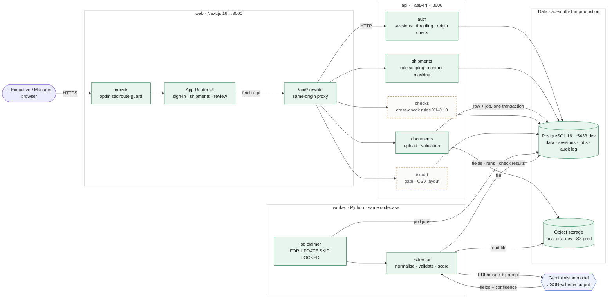
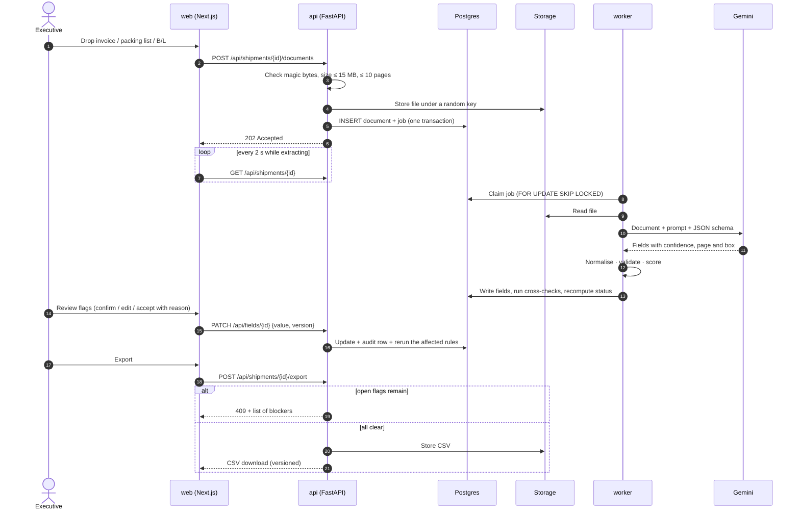
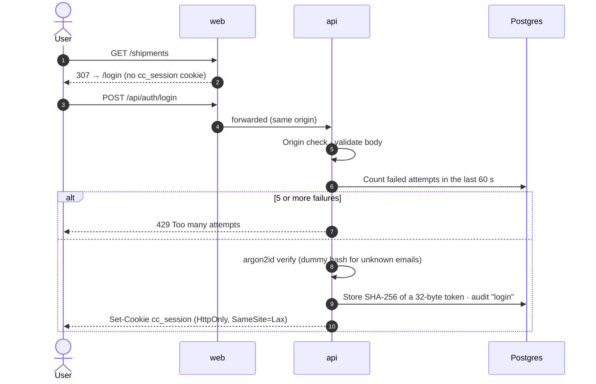
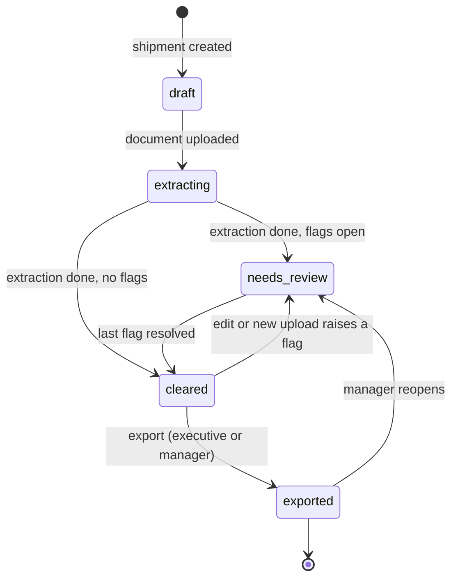
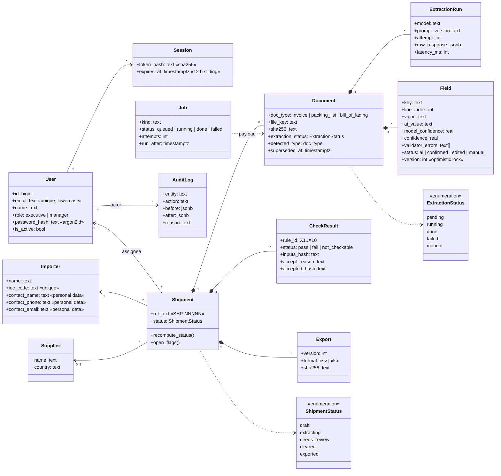

# Crosscheck

[](https://github.com/priyanshu14077/veridoc/actions/workflows/ci.yml)

**AI document extraction and cross-checks for a customs broker's import shipments.**

A documentation executive drops in a shipment's **invoice, packing list and bill of lading**. A vision model extracts the fields with a confidence score on each. Deterministic rules check the three documents against each other (totals, packages, weights, containers). **Nothing exports until a person has cleared every uncertain or conflicting value.** The export is a file the existing customs filing software can import, so that software doesn't change.

| | |
|---|---|
| Client | Customs broker at Nhava Sheva, 1,100 shipments/month, documentation team of 14 |
| Problem | 45 min of retyping per shipment, plus a 3% error rate that forces amended Bills of Entry: **₹70.29 lakh/year** |
| Target | Entry under 15 min per shipment, 95% field accuracy, amended Bills of Entry halved |
| Docs | [Product requirements](docs/PRD.md) · [Technical design](docs/TDD.md) |

---

## Build status

| Area | State |
|---|---|
| Postgres schema, SQL migrations, seed data | ✅ Done |
| Sign-in, sessions, roles, login throttling | ✅ Done |
| Shipment list and detail, scoped by role, masked importer contacts | ✅ Done |
| CI (ruff, pytest, eslint, tsc) | ✅ Done |
| Document upload, Postgres job queue, Gemini extraction with fallback models | ✅ Done |
| Confidence scoring, format validators, unreadable → manual entry | ✅ Done |
| Synthetic sample documents + recorded extractions + eval script | ✅ Done |
| Review screen, cross-check engine, export gate, CSV export | 🔜 Planned |
| Edit history, accuracy report | 🔜 Planned |

---

## System architecture



<sub>Green = built · dashed amber = planned · blue = external service</sub>

### Services

| Service | Tech | Port (dev) | Responsibility | State |
|---|---|---|---|---|
| **web** | Next.js 16 (App Router, TypeScript), Tailwind v4, TanStack Query | 3000 | UI. Forwards `/api/*` to the API so the browser only talks to one origin (first-party cookie, no CORS) | ✅ |
| **api** | FastAPI, Pydantic v2, SQLAlchemy 2, psycopg 3 | 8000 | Auth, role and ownership checks, input validation, shipments, upload, checks, export | ✅ partial |
| **worker** | Python, same codebase as `api` (`python -m app.worker`) | n/a | Claims extraction jobs from Postgres, calls Gemini, normalises and scores fields; cross-checks next | ✅ |
| **db** | PostgreSQL 16 (Docker) | 5433 | All data, sessions, the **job queue** and the append-only audit log | ✅ |
| **storage** | Local disk (dev) / S3 `ap-south-1` (prod) | n/a | Uploaded documents and export files, private, never served from a public path | ✅ local |
| **Gemini** | `gemini-3.5-flash`, falling back to other Flash models on 503/429 | n/a | Vision extraction with a JSON response schema. Free tier on synthetic data for the demo; Vertex AI (India region) in production | ✅ |

**Why there's no Redis or Celery:** about 3,300 documents a month is far below where a Postgres-backed queue struggles. Keeping jobs in the same database makes "save the upload and enqueue the job" one transaction. See [TDD §2](docs/TDD.md#2-architecture).

---

## How a shipment moves through the system

### Upload → extraction → review → export



### Sign-in (built)



### Shipment lifecycle

`status` is never set directly. It's recomputed after every write from the documents, fields and check results, so the list, the export gate and the UI always agree.



A **flag** is any of these:
- a field below the confidence threshold that nobody has confirmed;
- a required field that is still empty;
- a failed or not-checkable cross-check that has no valid acceptance;
- a document whose extraction failed or hasn't finished.

---

## Data model (UML)



An **acceptance** of a mismatch only counts while `accepted_hash == inputs_hash`. If someone edits a value after the mismatch was accepted, the acceptance lapses, so nobody can wave a mismatch through and then change the number.

---

## Repository layout

```
.
├─ api/                    FastAPI app and extraction worker
│  ├─ app/
│  │  ├─ auth/             passwords, sessions, deps, routes
│  │  ├─ shipments/        access policy, routes, flags and status
│  │  ├─ documents/        upload, file streaming, retry, manual entry
│  │  ├─ extraction/       catalog, Gemini client, prompts, normalisers, validators, confidence
│  │  ├─ jobs.py           Postgres job queue (SKIP LOCKED, backoff)
│  │  ├─ worker.py         extraction worker
│  │  ├─ storage.py        local disk / S3 interface
│  │  ├─ audit.py          append-only audit writer
│  │  ├─ privacy.py        personal-data masking
│  │  ├─ migrate.py        SQL migration runner
│  │  └─ seed.py           idempotent demo data
│  ├─ migrations/          hand-written SQL
│  ├─ scripts/             generate_docs.py, record_fixtures.py, eval.py
│  └─ tests/               pytest, against a separate test database
├─ web/                    Next.js 16 app
│  └─ src/
│     ├─ app/              login, (app)/shipments, (app)/shipments/[id]
│     ├─ components/       app shell, status chip, UI primitives
│     ├─ lib/              API client, types, formatting
│     └─ proxy.ts          route guard (Next 16's replacement for middleware)
├─ sample-docs/            synthetic invoices, packing lists, B/Ls + ground truth + recorded extractions
├─ docs/                   PRD.md, TDD.md
├─ docker-compose.yml      Postgres 16 (dev + test databases)
└─ .github/workflows/      CI
```

---

## Run locally

**Prerequisites:** Docker, [uv](https://docs.astral.sh/uv/), Node 24.

```bash
# 1. Database (creates crosscheck + crosscheck_test on localhost:5433)
docker compose up -d db

# 2. API
cd api
cp .env.example .env
uv sync
uv run python -m app.migrate        # apply SQL migrations
uv run python -m app.seed           # demo users, 12 shipments, 35 documents (safe to re-run)
uv run uvicorn app.main:app --port 8000

# 3. Extraction worker (second terminal; needs GEMINI_API_KEY in api/.env)
cd api && uv run python -m app.worker

# 4. Web (third terminal)
cd web
cp .env.example .env.local
npm install
npm run dev                         # → http://localhost:3000
```

API docs: http://localhost:8000/api/docs · Health check: http://localhost:8000/api/health

### Demo accounts

All people and companies are fictional. Password for every account: `crosscheck-demo`

| Role | Email | Sees |
|---|---|---|
| Executive | `meera.exec@crosscheck.demo` | Their own shipments + the unassigned pool (8) |
| Executive | `rohan.exec@crosscheck.demo` | Their own shipments + the unassigned pool (7) |
| Manager | `anil.manager@crosscheck.demo` | All 12, plus override review and reports |

### Environment variables

Names only. Copy the `.env.example` files and never commit real values.

| Variable | Service | Purpose |
|---|---|---|
| `DATABASE_URL` | api | Postgres connection string |
| `SESSION_TTL_HOURS` | api | Idle session lifetime (default 12) |
| `COOKIE_SECURE` | api | `true` behind HTTPS |
| `ALLOWED_ORIGINS` | api | JSON list of origins allowed to make state-changing requests |
| `TRUST_PROXY` | api | Read client IP from `X-Forwarded-For` (behind the web proxy or a load balancer) |
| `SEED_DEMO_PASSWORD` | api | Password given to seeded demo users |
| `API_ORIGIN` | web | Where `/api/*` is forwarded |
| `GEMINI_API_KEY` | worker | Gemini key (free tier, synthetic data only) |
| `GEMINI_MODEL`, `GEMINI_FALLBACK_MODELS` | worker | Primary model and the models tried on 503/429 |
| `GEMINI_RPM` | worker | Calls per minute, kept under the free-tier limit |
| `CONFIDENCE_THRESHOLD` | api, worker | Fields below this are flagged (default 0.85) |
| `STORAGE_DIR`, `MAX_UPLOAD_MB` | api, worker | Where uploads are kept locally; upload size limit |

---

## Tests

```bash
cd api && uv run pytest        # 22 tests against crosscheck_test
cd web && npx eslint src && npx tsc --noEmit
```

The test suite refuses to run against any database except `crosscheck_test`. It covers:
- **Passwords and sessions:** argon2id round trip; only the token hash is stored; logout revokes; expired sessions are rejected.
- **Sign-in:** emails are case-insensitive; an unknown email and a wrong password get identical responses; the sixth try in a minute gets 429; requests from a foreign site get 403.
- **Access control:** executives can't see each other's shipments (404); manager vs executive scope; status counts follow the search and the role.
- **Input validation:** bad query parameters and bodies get 422.
- **Privacy:** contacts are masked in the detail view; each reveal is logged; only the assigned executive or a manager can reveal.

CI runs all of this on every push.

---

## Security and privacy

- **No secrets in the repo.** `.env*` is git-ignored and only the `.env.example` templates are tracked.
- **Sessions:** argon2id password hashes. 32-byte random session tokens, stored as SHA-256. Cookie is `HttpOnly; SameSite=Lax` (`Secure` in production).
- **CSRF:** SameSite=Lax, plus an `Origin` allow-list on POST, PUT, PATCH and DELETE.
- **Access control:** one policy module (`app/shipments/access.py`) used by every route that touches a shipment. Out-of-scope shipments return 404 rather than 403, so their existence isn't revealed.
- **Personal data (DPDP Act 2023):** importer contacts are masked by default. Revealing one is an explicit action, allowed only for the assignee or a manager, and recorded in `audit_log`.
- **AI and client data:** the demo runs Gemini's free tier on **synthetic documents only**. Production targets Vertex AI in an Indian region, whose terms exclude training on customer data. See [TDD §5.7](docs/TDD.md#57-provider-privacy-and-cost).

---

## Documentation

- [docs/PRD.md](docs/PRD.md): users, scope, flows, cross-check rules, assumptions A1–A13
- [docs/TDD.md](docs/TDD.md): architecture, data model, AI design and evaluation, API surface, security, what was cut
